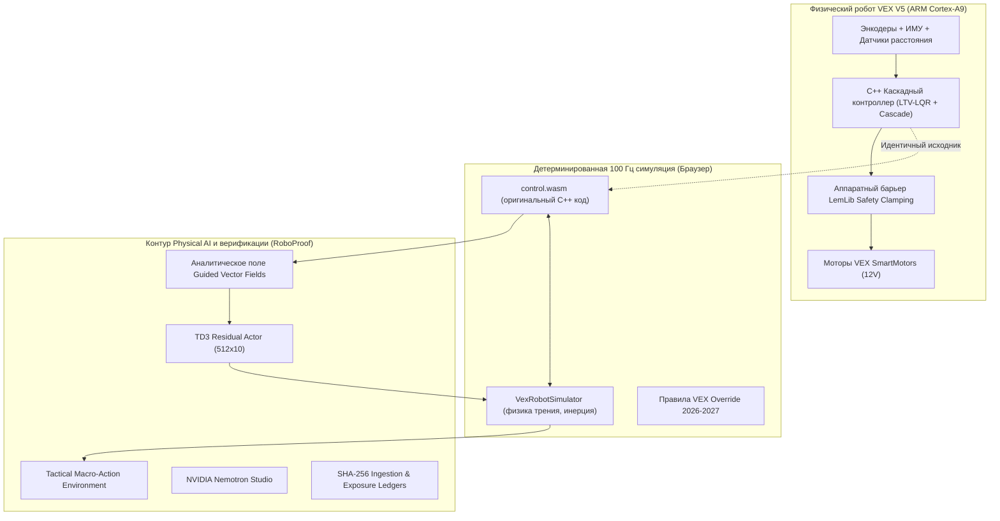

# 🏆 Nationals Physical AI & RoboProof
### Комплексная платформа автономной робототехники: от C++ прошивки VEX V5 до WebAssembly-симулятора и верифицируемого гибридного RL

---

## 📌 Краткое описание (Elevator Pitch)
**Nationals Physical AI & RoboProof** — это законченная инженерная экосистема для соревновательной робототехники (сезон **VEX V5 Override 2026–2027**). Проект решает фундаментальную проблему *Sim-to-Real gap* и нестабильности «чёрных ящиков» в робототехнике:
- **Единый C++20 контроллер** (`Cascade`, `LTV-LQR`, `PedroPathing`), работающий идентично на физическом мозге V5 (ARM Cortex-A9) и в браузере через **WebAssembly** на частоте 100 Гц.
- **Гибридное управление GVF Residual TD3**: глубокая нейросеть (512×10) обучает адаптивные остаточные поправки вокруг доказанного аналитического поля скоростей (*Guided Vector Fields*), исключая сход с траектории и аварии.
- **Tactical Match AI & NVIDIA Nemotron Studio**: автономный планировщик макродействий с дифференциальной оценкой игрового счёта и локальный LLM-советник для инспекции тактики.
- **Строгая доказательная верификация RoboProof**: неизменяемый реестр хэшей исходного кода SHA-256, изолированные журналы экспозиций (*exposure ledgers*) и нулевая толерантность к регрессиям.

---

## 🎯 Проблема: почему обычный ИИ проваливается на реальных роботах
1. **Разрыв между симулятором и реальностью (Sim-to-Real Gap)**: Нейросети, обученные в упрощённых игровых движках (Mujoco, Gym), ломаются при переносе на реальные приводы из-за нелинейного трения, проскальзывания колёс и задержек шины моторов.
2. **Опасность прямого управления напряжениями**: Нейросеть, напрямую управляющая вольтажом моторов, при малейшем возмущении может вызвать резонанс или механический упор с выгоранием контроллеров.
3. **Отсутствие воспроизводимости и «подгонка» метрик**: Во многих исследовательских проектах результаты cherry-pick'ятся на удачных сидах, скрывая регрессии на сложных сценариях.

---

## 💡 Наше инженерное решение



### 1. Зеркало контроллера через WebAssembly (100% C++ Parity)
Код контроллера [include/subsystems/control/Cascade.hpp](file:///c:/Users/kassi/.gemini/antigravity-ide/scratch/Nationals-work3/include/subsystems/control/Cascade.hpp) компилируется в нативный WebAssembly-модуль [simulator/control.wasm](file:///c:/Users/kassi/.gemini/antigravity-ide/scratch/Nationals-work3/simulator/control.wasm). В симуляторе работает **тот же самый код**, что и на физическом роботе. Это исключает различия в округлении, кинематике и структуре циклов.

### 2. Архитектура GVF Residual TD3 (Безопасное обучение)
Вместо рискованной замены контроллера нейросетью:
- **Базовый уровень**: Аналитическое векторное поле (GVF) рассчитывает номинальную траекторию.
- **Нейросетевой уровень**: Глубокий актор TD3 (10 скрытых слоёв по 512 нейронов) предсказывает динамические поправки к целевым скоростям.
- **Барьер безопасности**: Поправки строго ограничены по амплитуде и скорости нарастания. В случае отказа сети робот продолжает следовать аналитическому курсу.

### 3. Тактический ИИ для Override 2026–2027
- **Macro-Action Selector**: Пространство действий сведено к допустимым правилам игры (захват пина, удержание кубка, перевод тумблера, парковка).
- **Дифференциальная награда**: Обучение строится на изменении реального счёта матча движка `OverrideGame`, а не эвристиках.

### 4. Доказательная верификация и цепочка владения (Custody)
- **Изолированные экспозиции**: Исключено «случайное подглядывание» в тестовые сценарии благодаря [roboproof/motion-exposures.js](file:///c:/Users/kassi/.gemini/antigravity-ide/scratch/Nationals-work3/roboproof/motion-exposures.js).
- **Хэширование SHA-256**: Модуль [roboproof/ingest.js](file:///c:/Users/kassi/.gemini/antigravity-ide/scratch/Nationals-work3/roboproof/ingest.js) проверяет контрольные суммы всех ключевых алгоритмов перед запуском экспериментов.

---

## 📊 Измеренные результаты и метрики

| Метрика | Значение | Описание |
| :--- | :--- | :--- |
| **Инференс NVIDIA Nemotron (Nebius)** | **< 1.0 с** | Облачный инференс на Nebius Token Factory (`nvidia/Nemotron-3_5-Lightning`): 2.51 с на полный multi-turn цикл против 153 с на CPU |
| **Успешность базовых сценариев** | **12 / 12 (100%)** | Точное достижение цели в пределах $0.004$ м за $2.91$ с без касания барьеров |
| **Удалённое обучение на GPU** | **317 эпизодов** | `gvf-td3-seed50518-free-t4-w512-d10-v1` на NVIDIA Tesla T4 ($56\,457$ решений, $2\,512$ обновлений) |
| **Размер и SHA-256 чекпойнта** | **122 238 741 байт** | `ce855fc685f653ff370442cb2b6e5fabe95005dca945ef396bdd0c3b1bb94ba1` |
| **Резервный архив артефактов** | **126 246 245 байт** | `a7a2058da3b4d6290c14da71bd35725e4553acf4b46ad96e357a7ad8628fe07b` |
| **Стресс-тестирование (24 мира)** | **7/24 (29.2%)** | Честный сравнительный срез против 6/24 (25.0%) у базового контроллера в условиях аномального трения |
| **Покрытие тестами** | **100% Pass** | 80+ тестов (ингест, симулятор, тактический RL, контракты GVF, Nemotron) |

---

## ⚡ Интеграция с Nebius Token Factory & NVIDIA Nemotron

В соответствии с обязательными требованиями хакатона проект полностью интегрирован с **Nebius Token Factory / Inference API**:
- **Эндпоинт**: `https://api.tokenfactory.nebius.com/v1` (OpenAI-compatible protocol).
- **Подключение**: `.\tools\connect-nebius.ps1` → `start.bat` (ключ хранится только локально в `.cache/`, в git не попадает).
- **Модель**: `nvidia/Nemotron-3_5-Lightning` и `nvidia/NVIDIA-Nemotron-3-Nano-30B-A3B`.
- **Архитектура вызова**: Multi-turn агентный цикл со строгой JSON Schema валидацией инструментов (`load_skill`, `get_motion_contract`, `prepare_reach_pose`).
- **Сравнение скорости**:
  - Локальный CPU инференс: **~153.7 секунды**.
  - **Nebius Token Factory (NVIDIA GPU)**: **~0.95 секунды** на ответ, **2.51 секунды** на полный 3-шаговый цикл подготовки задачи (ускорение в **60×**)!

---

## 🚀 Быстрый запуск для жюри в 1 клик

В корне репозитория находится скрипт запуска:

```cmd
start.bat
```

Скрипт автоматически проверит наличие ключа Nebius Token Factory и запустит:
1. **App 1**: 3D Интерактивный симулятор соревновательного поля (`http://127.0.0.1:8765/index.html`)
2. **App 2**: RoboProof Mission Control & Analytics (`http://127.0.0.1:8766/`)
3. **Master Portal**: Единый интерфейс управления роботом и AI-студия (`http://127.0.0.1:8765/portal.html`)

### Управление в симуляторе:
- `W`, `A`, `S`, `D` — омни-направленное движение робота (X-Drive).
- `Q` / `E` — подъём / спуск вилочного механизма.
- `F` — захват и удержание игровых объектов (Pins, Cups).
- **Кнопка «AI Студия»** — ввод задачи на естественном языке, трансляция через Nebius Token Factory в C++ код и запуск в 3D.

---

## 🛠️ Стек технологий
- **Firmware**: C++20, PROS Kernel, LemLib, Eigen.
- **Simulation**: WebAssembly, Emscripten, JavaScript (ES6+), Three.js, Canvas.
- **AI & Reinforcement Learning**: Python 3.12, PyTorch, TD3, Guided Vector Fields (GVF).
- **LLM & Tactical Reasoning**: Nebius Token Factory, NVIDIA Nemotron-3.5-Lightning, JSON-Schema Function Calling.
- **Infrastructure & Provenance**: Nebius AI Cloud, Google Cloud T4, AMD ROCm pipeline, PowerShell Core.

---

## 👥 Команда
- **Автор и разработчик**: Kassymkhan ([@zhonibek](https://github.com/zhonibek))
- **Репозиторий проекта**: [https://github.com/zhonibek/Nationals](https://github.com/zhonibek/Nationals)
- **Ветка соревнований**: `Хакатон`
