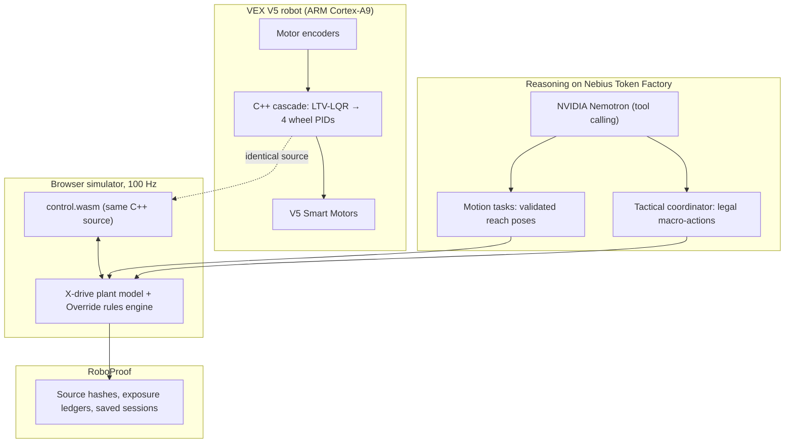

# Nationals Physical AI & RoboProof

**Track:** Physical AI · **Nebius × NVIDIA Global AI Hackathon 2026**

An autonomy stack for a VEX V5 competition robot (V5RC Override 2026–2027): one C++20 controller that runs on the robot and, compiled to WebAssembly, in a browser field simulator; NVIDIA Nemotron on **Nebius Token Factory** as a tool-calling coordinator for motion tasks and match tactics; and RoboProof, which records evidence for every claim.

---

## Elevator pitch

Competition robots fail in two ways: controllers tuned in a toy simulator behave differently on the field, and "AI" that drives motors directly is unsafe and unverifiable. We keep a proven analytical controller in charge of the motors and let AI work above it:

- **One controller, two targets.** The same C++ cascade (`LTV-LQR → four wheel PIDs + feedforward`) is compiled for the V5 Brain (ARM Cortex-A9) and to `control.wasm` for the simulator, so the simulator tests the code that drives the robot.
- **Nemotron as a coordinator, not a motor driver.** Through Nebius Token Factory, Nemotron turns natural-language requests into validated motion tasks and chooses match tactics from an allowlist of legal macro-actions. A deterministic orchestrator and the rules engine execute and score them.
- **Evidence instead of claims.** RoboProof binds results to source hashes, keeps failed runs and refuses to report an improvement without an independent comparison.

---

## The problem

1. **Sim-to-real gap.** Policies trained in simplified engines break on real drivetrains because of friction, slip and latency. If the simulator runs different control code than the robot, its results say little about the robot.
2. **Unsafe direct control.** A network that outputs motor voltages can oscillate or damage the mechanism after a small disturbance.
3. **Unreproducible results.** Many robotics-AI results are picked from lucky seeds and hide regressions.
4. **Strategy under time pressure.** In a 1:45 driver period, choosing *what* to score matters as much as driving well. Teams learn the best cycles by experience; that knowledge is rarely encoded.

---

## What we built



### 1. Controller parity through WebAssembly
[`include/subsystems/control/Cascade.hpp`](include/subsystems/control/Cascade.hpp) is compiled into [`simulator/control.wasm`](simulator/control.wasm). Source hashes in [`simulator/control-build.json`](simulator/control-build.json) are checked by tests, so a stale WASM build fails. The simulator gives the controller only encoder odometry and wheel velocities, never ground truth.

### 2. Nemotron motion coordinator
A request such as "drive forward 24 inches from (0,0,0) to (0,24,0)" goes to Nemotron with a small set of tools. The model must call `load_skill → get_motion_contract → prepare_reach_pose`; the task is validated (bounds, units, deadline) and executed only after a separate user approval, in the original simulator, with exact replay. Ambiguous requests end with `ask_clarification` instead of a guess.

### 3. Tactical AI for Override
The rules engine (`simulator/override.js`) scores every action. The tactical layer offers a bounded set of legal macro-actions — score a field object, **score a match load from the loading zone**, flip a Toggle, park — and previews each one in a cloned game. Nemotron chooses among these candidates by tool call; invalid choices fail closed. A score-driven actor-critic is trained on the same environment on a remote T4. See [Tactical AI results](#tactical-ai-results).

### 4. Safe learning around an analytical controller
An analytical Guided Vector Field (GVF) defines the nominal path; a residual TD3 actor may add only bounded, rate-limited corrections. If the network fails, the robot keeps following the analytical field.

### 5. RoboProof evidence
[`roboproof/ingest.js`](roboproof/ingest.js) checks SHA-256 hashes of the reviewed algorithms before an experiment; exposure ledgers ([`roboproof/motion-exposures.js`](roboproof/motion-exposures.js)) prevent reusing evaluation scenarios for training. Negative results are kept and reported.

---

## How we use NVIDIA Nemotron and Nebius Token Factory

| | |
| :--- | :--- |
| **Endpoint** | `https://api.tokenfactory.nebius.com/v1` (OpenAI-compatible), runtime calls from [`roboproof/nemotron.js`](roboproof/nemotron.js) |
| **Model** | `nvidia/Nemotron-3_5-Lightning` for fast per-step tool calls |
| **Pattern** | Multi-turn native function calling with JSON-Schema-validated tools; one tool call per turn; bounded turns and tokens |
| **Safety** | The model can only choose allowlisted tools and candidate IDs. It never outputs motor commands, code to execute or scores. |
| **Key handling** | `tools/connect-nebius.ps1` stores the key in the Git-ignored `.cache/`; the key never reaches the browser or the repository |

**Where Token Factory accelerated our workflow.** Before the hackathon, Nemotron ran on a laptop CPU: one measured planning request took **153.7 s** (cold) and **73.8 s** (warm cache). On Nebius Token Factory, a model check takes **0.47 s**, a clarification answer about **0.9 s**, and the full three-tool motion-planning loop completes in seconds. That made interactive use in the simulator and per-decision tactical choices practical.

---

## Measured results

| Metric | Value | Notes |
| :--- | :--- | :--- |
| Nemotron on Nebius Token Factory | 0.47 s model check, ~0.9 s single turn | Smoke checks on 2026-10-24, not a benchmark |
| Nemotron on laptop CPU (before) | 153.7 s cold, 73.8 s warm | Same planning task, 2026-10-01 |
| Approved motion task in the original simulator | Goal reached in 2.91 s, position error 0.0012 m, no contact | Scripted controller selected through real Nemotron inference, exact replay |
| Remote GPU training | 317 episodes, 56,457 decisions, 2,512 updates | `gvf-td3-seed50518-free-t4-w512-d10-v1` on an NVIDIA Tesla T4 |
| Checkpoint | 122,238,741 bytes | SHA-256 `ce855fc685f653ff370442cb2b6e5fabe95005dca945ef396bdd0c3b1bb94ba1` |
| Stress test, 24 worlds | 7/24 (29.2%) vs 6/24 (25.0%) for the baseline controller | Anomalous friction; difference is not statistically established |
| Automated tests | 588 Node tests: 585 pass, 2 skipped, 1 needs Python on `PATH` (passes with it) | Plus C++ safety tests and simulator suites |

We report learned-motion improvement as **not verified** (`learnedImprovementVerified: false`) until an independent comparison passes.

### Tactical AI results

One driver period (red alliance, seeds 101 and 102), scored by the Override rules engine in the abstract tactical model. Margin = own score − opponent score; the opponent robots are idle.

**Timing calibrated to the real robot (2026-10-25).** The team measured about **2 s per loading-zone cycle** and **4 s per field cycle** on the competition robot. The model's speed comes from the drive configuration (X-drive, 3.25″ wheels, 200 rpm: 48.1 in/s), and the pickup times are fitted so that a typical cycle in this field geometry takes the measured time: 0.31 s to take a match load, 2.67 s to approach, align and take a field object, 0.4 s to place. Field objects lie closer to goals than the loaders (22 vs 31 inches), so the difference comes from handling, as the team sees on the field.

| Coordinator (measured timing) | Mean margin | Match loads scored | Decision time |
| :--- | ---: | ---: | :--- |
| **Loading-zone cycles** (team tactic) | **246** | 12 | — |
| **Nemotron 3.5 Lightning** on Nebius Token Factory | **231** | 20 | 0.6 s |
| Field greedy (best points/second, no match loads) | 218 | 0 | — |
| Greedy over all actions | 203 | 18 | — |
| Nemotron Super 120B on Nebius Token Factory | 203 (seed 101) | 18 | 1.7 s |
| Random legal action | 62.5 | 6 | — |

- With the robot's real timing, the team's loading-zone tactic is the best one, matching their experience on the field.
- Nemotron Lightning beats both greedy baselines and field play and scores 20 match loads, but stays 15 points behind the hand-made loading-zone tactic. Super completed seed 101; on seed 102 it returned an invalid tool call at decision 14 and the match stopped by design (fail closed), so it has no two-seed mean.
- Before calibration (nominal 24 in/s and 1.25 s pickups) the order was the opposite: field greedy 228, loader-cycle 182, Nemotron Super 181, greedy-all 173, Lightning 163, random 79. Measured cycle times changed which tactic wins, which is why the timing is now part of every result.
- **Trained actor-critic (free Colab Tesla T4, nominal timing).** Pilot: seed 731201, 100 episodes, held-out margin **102** vs loader-cycle 176.5 and field greedy 225.5. Longer fit: seed 731401, 1200 episodes, training margin rose from 74 to 117.5 but held-out margin stayed at **99.5**. Neither beats the loading-zone tactic (`beatsLoaderCycleOnHoldout: false`). Both ran before the timing calibration; the next fit uses the measured profile.
- **Trained actor-critic on the measured timing (free Colab Tesla T4, seed 732701, 500 episodes, 2026-10-26).** The training margin rose from 82.7 (first 50 episodes) to about 116–120 (last 150). On 8 held-out start poses the learned policy reaches **112**, against loader-cycle 244.5, field greedy 221.25, greedy-all 203 and random 92.9 on the same seeds (`beatsLoaderCycleOnHoldout: false`). The learned policy improves on random play but stays far behind the hand-made loading-zone tactic and behind Nemotron Lightning (231 on seeds 101–102).
- **Warm start from the loading-zone tactic (free Colab Tesla T4, seed 734001, 2026-10-26).** The actor first imitated 17 `loader-cycle` matches (behavior cloning; afterwards it picks the tactic's move 61% of the time), then trained with RL for 300 episodes. On 8 held-out start poses it reaches **191.5**, the best learned result so far (112 before), against loader-cycle 244.5, field greedy 220.75, greedy-all 203 and random 82.1 on the same seeds (`beatsLoaderCycleOnHoldout: false`). The gain comes from the warm start: during RL the training margin stayed at about 181.
- Next: parallel robots and richer match state for the learned policy; with the current features, more training did not close the gap.

---

## Built during the submission period

The repository's first commit is dated 2026-09-17, after the submission period opened on 2026-08-26. Everything in it was built or substantially rewritten during the hackathon: the C++ cascade and its WebAssembly build, the Override simulator and rules engine, RoboProof, the GVF residual learning pipeline, the tactical environment, and the Nemotron / Nebius Token Factory integration.

## Originality and attribution

- The project's own code is MIT-licensed: Copyright (c) 2026 Kassymkhan and Nationals contributors.
- **Pedro Pathing** is an FTC path-following library originally written in **Java**. Our `include/subsystems/pedro/` and `src/subsystems/pedro/` are an independent **C++ rewrite** for VEX V5 based on its design; no Java code is included. Its BSD-3-Clause notice is retained.
- **LemLib** (MIT), **PROS** (MPL-2.0), **Eigen** (MPL-2.0) and **{fmt}** (MIT) are included; Three.js is loaded from a CDN.
- Full list: [`THIRD_PARTY_NOTICES.md`](THIRD_PARTY_NOTICES.md).

---

## Run it

```powershell
.\tools\connect-nebius.ps1   # once: paste a Nebius Token Factory API key
.\start.bat                  # simulator, RoboProof and the portal
```

1. **Simulator:** <http://127.0.0.1:8765/index.html> — 2D/3D Override field with the WASM controller.
2. **RoboProof:** <http://127.0.0.1:8766/> — Motion Lab, Nemotron coordinator, evidence.
3. **Portal:** <http://127.0.0.1:8765/portal.html> — both side by side.

Simulator controls: `W`/`A`/`S`/`D` move the X-drive, arrows turn, `E`/`Q` raise/lower the lift, `F` takes a Pin/Cup or flips a Toggle, `G` places, `R` releases. **AI Programming** opens the natural-language motion studio; **Ask tactical AI** asks Nemotron for the next move.

Without a Nebius key, the simulator and controller still work; only Nemotron features are unavailable. Requirements: Windows with PowerShell and Node.js 20+.

---

## Feedback on Nebius Token Factory and NVIDIA Nemotron

- **What worked well.** The OpenAI-compatible API meant our existing tool-calling client needed only an endpoint, key and model change. Native function calling with `Nemotron-3_5-Lightning` followed our multi-step tool protocol (`load_skill → get_motion_contract → prepare_reach_pose`) and asked for clarification on underspecified requests instead of inventing coordinates. Latency (about a second per turn) made per-decision tactical calls feasible.
- **What we would improve.** `tool_choice: "required"` support and its exact semantics for each model were not obvious from the model list; we use `auto` and fail closed when no tool is called. A documented, stable model alias per family (Nano / Lightning / Super / Ultra) and published context and output limits in `/v1/models` would make configuration safer. Clearer error bodies for unknown model IDs would help: a typo in a model name is easy to make.
- **Nemotron model family.** Having Nano, Lightning, Super and Ultra behind one API lets a robot use a fast model for each step and a larger model for planning — a natural fit for Physical AI.

---

## Tech stack

- **Firmware:** C++20, PROS kernel, LemLib, Eigen.
- **Simulation:** WebAssembly (C++ compiled with Zig/Clang), JavaScript, Three.js, Canvas.
- **Learning:** Python, PyTorch, TD3, PPO, Guided Vector Fields.
- **Reasoning:** NVIDIA Nemotron on Nebius Token Factory, JSON-Schema function calling.
- **Infrastructure and provenance:** Google Colab T4 for training runs, PowerShell, Node.js test runner, SHA-256 provenance.

## Team

- **Author and developer:** Kassymkhan ([@zhonibek](https://github.com/zhonibek))
- **Repository:** <https://github.com/zhonibek/Nationals> (default branch `nvidia-nebius-global-ai-hackathon`)
- **License:** MIT
