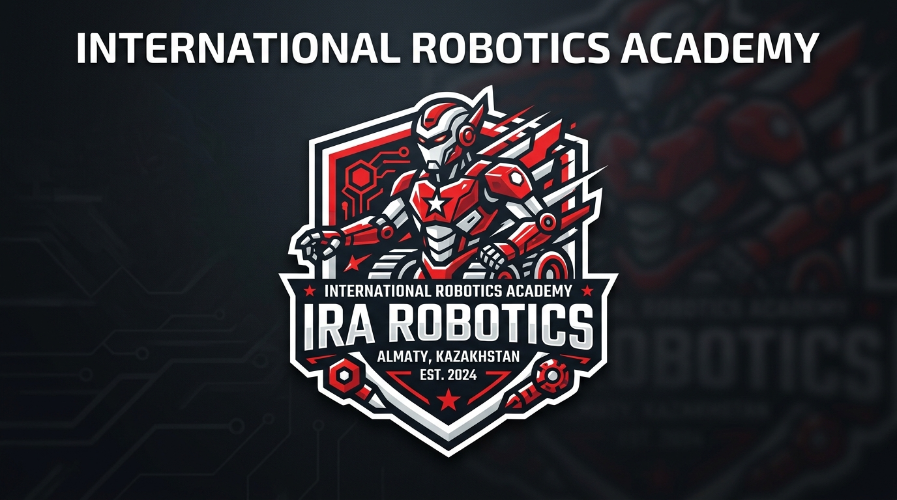
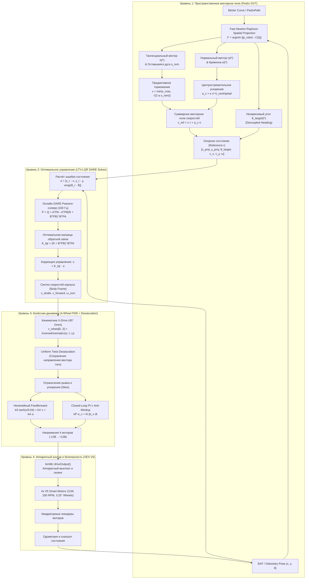

<p align="center">
  
</p>

<p align="center">
  
  
  
  
  
  
</p>

<hr>

# IRAlib — Unified Holonomic Control Architecture
### Pedro GVT (Guiding Vector Tracking) + LTV-LQR (DARE Optimal State Feedback) + 4-Wheel PIDf Cascade

**IRAlib** is the flagship VEX V5 robotics control framework developed at the **International Robotics Academy (Almaty, Kazakhstan)** for competitive robotics, engineered specifically for the National Championship and international VEX World Championships.

This branch (**`COMPETITION`**) unifies two historically separate paradigms in competitive mobile robotics into a single, high-performance **3-level cascaded control pipeline**:
1. **Pedro GVT (Guiding Vector Tracking / Guiding Vector Field)**: Time-independent, reactive vector field path following along Bézier curves with predictive braking and centripetal feedforward.
2. **LTV-LQR (Linear Time-Varying Linear Quadratic Regulator)**: Online solution of the Discrete Algebraic Riccati Equation (**DARE**) at 100 Hz, computing optimal multi-variable state feedback gains to asymptotically stabilize Cartesian pose and decoupled heading.
3. **Inner-Loop 4-Wheel PIDf Controller**: Hyperbolic-tangent stiction compensation ($kS \cdot \tanh$), acceleration feedforward ($kA$), back-EMF compensation ($kV$), closed-loop PI velocity tracking with anti-windup, and uniform vector desaturation.

---

## ⚡ Architectural Overview & System Flow

Traditional trajectory trackers (e.g. classical Pure Pursuit, RAMSETE, or time-parameterized Hermite splines) assign an immutable timestamp $t$ to each coordinate. When physical disturbances occur (such as defense pinning, wheel slip, or game piece collisions), time-based trackers experience massive lag, clock desynchronization, and violent motor saturation upon release.

By integrating **Pedro GVT** as the spatial reference generator for an **LTV-LQR + PID Cascade**, the robot eliminates clock drift entirely while maintaining mathematical optimality in motor voltage distribution:



---

## 📐 Математическая модель каскада

### 1. Pedro GVT: Пространственная параметризация и векторное поле
Кривая Безье степени $n$ задаётся контрольными точками $P_0, P_1, \dots, P_n$:
$$\mathbf{C}(t) = \sum_{i=0}^n \binom{n}{i} (1 - t)^{n-i} t^i P_i, \quad t \in [0, 1]$$

#### 1.1 Быстрая ортогональная проекция
Вместо привязки к таймеру алгоритм на каждом шаге $\Delta t = 10\text{ мс}$ находит параметр $t^*$, минимизирующий евклидово расстояние от физической позы робота $\mathbf{p}_{robot} = [x, y]^T$ до кривой:
$$t^* = \arg\min_{t \in [0, 1]} \|\mathbf{p}_{robot} - \mathbf{C}(t)\|$$
Поиск осуществляется за два этапа: грубый поиск по сетке вокруг предыдущего значения $t_{last}$ и быстрая субпиксельная локализация.

#### 1.2 Векторное поле скоростей (Guiding Vector Field)
В точке $\mathbf{C}(t^*)$ вычисляются единичный касательный вектор $\hat{\mathbf{T}}(t^*)$, вектор нормали $\hat{\mathbf{N}}(t^*)$ и локальная кривизна $\kappa(t^*)$:
$$\hat{\mathbf{T}}(t^*) = \frac{\mathbf{C}'(t^*)}{\|\mathbf{C}'(t^*)\|}, \quad \hat{\mathbf{N}}(t^*) = \begin{bmatrix} -T_y \\ T_x \end{bmatrix}, \quad \kappa(t^*) = \frac{x' y'' - y' x'}{(x'^2 + y'^2)^{3/2}}$$

Скорость движения по пути формируется предиктивным профилем торможения (Predictive Braking Profile):
$$v_{target} = \min \left( v_{max}, \; \sqrt{2 \cdot a_{max} \cdot s_{rem}(t^*)}, \; \sqrt{\frac{a_{lat\_max}}{|\kappa(t^*)| + \epsilon}} \right)$$
где $s_{rem}(t^*)$ — истинная оставшаяся длина дуги до конца траектории.

Итоговый вектор скорости поля в глобальных координатах:
$$\mathbf{v}_{ref} = \hat{\mathbf{T}}(t^*) \cdot v_{target} + \hat{\mathbf{N}}(t^*) \cdot \left( v_{target}^2 \cdot \kappa(t^*) \cdot k_{centripetal} \right)$$

---

### 2. LTV-LQR: Оптимальное управление в пространстве состояний

В отличие от эвристических пропорциональных регуляторов, LTV-LQR минимизирует интегральный квадратичный функционал качества:
$$J = \sum_{k=0}^{\infty} \left( \mathbf{e}_k^T Q \mathbf{e}_k + \mathbf{u}_k^T R \mathbf{u}_k \right)$$

#### 2.1 Вектор ошибки и линеаризация кинематики X-Drive
Ошибка между опорным состоянием GVT $\mathbf{r}$ и одометрией $\mathbf{fb}$:
$$\mathbf{e} = \begin{bmatrix} e_x \\ e_y \\ e_\theta \end{bmatrix} = \begin{bmatrix} r_x - fb_x \\ r_y - fb_y \\ \text{wrap}(r_\theta - fb_\theta) \end{bmatrix}$$

Непрерывная матричная модель ошибок дифференциального/голономного движения во вращающемся базисе:
$$\dot{\mathbf{e}} = A \mathbf{e} + B \mathbf{u}$$
$$A = \begin{bmatrix} 0 & 0 & v_y \\ 0 & 0 & -v_x \\ 0 & 0 & 0 \end{bmatrix}, \quad B = \begin{bmatrix} \cos(\theta) & \sin(\theta) & 0 \\ -\sin(\theta) & \cos(\theta) & 0 \\ 0 & 0 & 1 \end{bmatrix}$$

#### 2.2 Дискретизация и онлайн-решение уравнения Риккати (DARE)
С шагом квантования $\Delta t$ дискретные матрицы вычисляются через ряд Тейлора:
$$A_d = I + A \Delta t, \quad B_d = B \Delta t$$

На микроконтроллере ARM Cortex-A9 с частотой 100 Гц в реальном времени решается Дискретное Алгебраическое Уравнение Риккати:
$$P = Q + A_d^T P A_d - A_d^T P B_d \left( R + B_d^T P B_d \right)^{-1} B_d^T P A_d$$

Оптимальная матрица коэффициентов обратной связи $K_{lqr}$:
$$K_{lqr} = \left( R + B_d^T P B_d \right)^{-1} B_d^T P A_d$$
$$u_{opt} = K_{lqr} \cdot \mathbf{e}$$

Суммарная скорость в базисе робота:
$$v_{strafe} = v_{ref, x} \cos(\theta) - v_{ref, y} \sin(\theta) + u_{opt, 0}$$
$$v_{forward} = v_{ref, x} \sin(\theta) + v_{ref, y} \cos(\theta) + u_{opt, 1}$$
$$\omega_{turn} = \omega_{ref} + u_{opt, 2}$$

---

### 3. Кинематика X-Drive и внутренний контур напряжения (PIDf)

Робот использует шасси X-Drive с 4 колесами Omni, установленными под углом $45^\circ$:

<p align="center">
  
</p>

```
       Front (+Y)
    FL \       / FR
        \     /
         [===]
        /     \
    BL /       \ BR
```

#### 3.1 Обратная кинематика
Для эффективного радиуса базы $R = \frac{W + L}{2\sqrt{2}}$ линейные скорости каждого колеса:
$$\begin{bmatrix} v_{FL} \\ v_{BL} \\ v_{FR} \\ v_{BR} \end{bmatrix} = \begin{bmatrix} 
\frac{\sqrt{2}}{2} & \frac{\sqrt{2}}{2} & R \\
-\frac{\sqrt{2}}{2} & \frac{\sqrt{2}}{2} & R \\
-\frac{\sqrt{2}}{2} & \frac{\sqrt{2}}{2} & -R \\
\frac{\sqrt{2}}{2} & \frac{\sqrt{2}}{2} & -R
\end{bmatrix} \begin{bmatrix} v_{strafe} \\ v_{forward} \\ \omega_{turn} \end{bmatrix}$$

#### 3.2 Равномерная десатурация (Uniform Twist Desaturation)
Если хотя бы одно колесо превышает максимальную конструктивную скорость $v_{max\_wheel}$, скорости всех 4 колес пропорционально масштабируются единым скаляром:
$$k_{scale} = \max \left( 1.0, \; \frac{\max_{i} |v_i|}{v_{max\_wheel}} \right), \quad v_i \leftarrow \frac{v_i}{k_{scale}}$$
**Критическое преимущество:** вектор направления движения и курсовой разворот не искажаются при насыщении моторов.

#### 3.3 Закон напряжения моторов (PIDf Voltage Law)
Напряжение $V_i$ для каждого мотора $i \in \{0, 1, 2, 3\}$:
$$V_i = \underbrace{kS \cdot \tanh\left(\frac{v_i}{0.04}\right)}_{\text{Статическое трение}} + \underbrace{kV \cdot v_i}_{\text{Противо-ЭДС}} + \underbrace{kA \cdot a_i}_{\text{Инерционный момент}} + \underbrace{kP \cdot (v_i - v_{actual, i}) + kI \cdot \int (v_i - v_{actual, i}) dt}_{\text{Обратная связь PI}}$$
с условным интегрированием (Anti-Windup), блокирующим накопление интеграла при насыщении $V_i \ge 12.0\text{ В}$.

---

## 📊 Сравнительный анализ архитектур

| Характеристика | Classical Pure Pursuit | RAMSETE (Time-Indexed) | Standalone Pedro GVT | **IRAlib: Pedro GVT + LTV-LQR Cascade** |
| :--- | :--- | :--- | :--- | :--- |
| **Параметризация** | Время / Carrot Point | Время $t$ | Пространство (Geometry) | **Пространство (GVT) + Оптимальное время (LQR)** |
| **Реакция на удар в защите** | Срыв таймера, накопление ошибки | Насыщение приводов при освобождении | Плавный возврат (эвристика) | **Мгновенный оптимум Риккати, возврат без рывка** |
| **Привод шасси** | Танк (Non-holonomic) | Только дифференциальный танк | Меканум / Голономик | **Голономный X-Drive (3-DOF) + Танк** |
| **Учёт динамики моторов** | Отсутствует | Отсутствует | Базовый P-контур | **Полный PIDf: $kS \cdot \tanh + kV + kA$ + Anti-Slip** |
| **Защита от срыва вектора** | Нет (клиппинг напряжений) | Частичная | Нет | **Равномерная десатурация (Twist Desaturation)** |
| **Математические гарантии** | Нет | Локальная устойчивость | Геометрическая сходимость | **Глобальная устойчивость по Ляпунову ($H_2$ оптимум)** |

---

## 🗂️ Структура проекта

```
Nationals/
├── include/
│   ├── autonomous.hpp                     # Главный соревновательный API движений
│   ├── robot_config.hpp                   # Конфигурация портов, геометрии и шестерней X-Drive
│   ├── lemlib/                            # Фундаментальная библиотека (Pose, Odom, Safety)
│   │   ├── chassis/odom.hpp               # Потокобезопасная одометрия и снапшоты
│   │   └── safety.hpp                     # Арбитраж владения моторами (Token lease system)
│   └── subsystems/
│       ├── control/
│       │   ├── Cascade.hpp                # Ядро каскада: DARE-солвер + 4-колёсный PIDf
│       │   ├── GVTReference.hpp           # Генератор пространственного вектора Pedro GVT
│       │   ├── BezierReference.hpp        # Параметризация кривых Безье
│       │   └── HolonomicMotion.hpp        # Аппаратный интерфейс исполнения каскада
│       ├── pedro/
│       │   ├── BezierCurve.hpp            # Математика кривых Безье (производные, кривизна)
│       │   ├── PedroPath.hpp              # Контейнер цепочек кривых и режимов угла
│       │   └── PedroFollower.hpp          # Библиотечный фолловер Pedro с поддержкой Cascade
│       └── trajectory/
│           └── QuinticSpline.hpp          # Генератор 5-х сплайнов с ограничением рывка (Jerk)
├── src/
│   ├── main.cpp                           # Точка входа PROS: competition initialize, opcontrol
│   └── subsystems/
│       ├── control/HolonomicMotion.cpp    # Исполнение followGVT() и followReference()
│       └── pedro/PedroFollower.cpp        # Реализация followCascade()
├── simulator/                             # Веб-симулятор физики V5RC Override на WebAssembly
│   ├── control.wasm                       # Скомпилированное C++ ядро Cascade.hpp
│   ├── control-runtime.js                 # JS-обёртка вызова WASM-ядра
│   ├── simulator.js                       # 2D/3D физический движок, контакты и одометрия
│   └── index.html                         # Интерактивный интерфейс симулятора
└── tests/
    ├── control-core.test.js               # 17 регрессионных тестов замкнутого контура
    └── gvt-cascade.test.js                # Тесты сходимости GVT и устойчивости к ударам
```

---

## 🚀 Соревновательный API и примеры использования

Все функции автономного движения объявлены в [`include/autonomous.hpp`](include/autonomous.hpp) и используют **единый неразрывный каскад LTV-LQR + PID**:

### 1. Автономное движение по кривой Безье с вектором GVT
```cpp
#include "main.h"
#include "autonomous.hpp"
#include "subsystems/pedro/BezierCurve.hpp"

void autonomous() {
    // Начало в точке (0, 0) с курсом 0° (Север)
    chassis.setPose(0, 0, 0);

    // Кубическая кривая Безье: P0(0,0) -> P1(0,16) -> P2(24,8) -> P3(24,24)
    // Робот плавно переместится в (24, 24), одновременно развернувшись до 90°
    pedro::BezierCurve curve({0, 0}, {0, 16}, {24, 8}, {24, 24});
    
    // Исполнение через Pedro GVT + LTV-LQR DARE + Wheel PID Cascade
    auto result = autoGVTBezier(curve, /*startHeading=*/0.0f, /*endHeading=*/90.0f, /*timeoutMs=*/4000);
    
    if (result == lemlib::MotionResult::Settled) {
        // Захват цели или заброс кольца
    }
}
```

### 2. Цепочка траекторий с независимым курсом (Decoupled Heading)
```cpp
void runComplexRoutine() {
    pedro::PedroPath path;
    path.addSegment(pedro::BezierCurve({0, 0}, {0, 20}, {20, 20}, {20, 40}));
    path.addSegment(pedro::BezierCurve({20, 40}, {20, 60}, {40, 60}, {48, 48}));
    
    // Режим удержания курса на целевой точке поля (например, на Mobile Goal)
    path.setFacingPoint(pedro::Point(24.0f, 24.0f));
    
    // Запуск через соревновательный каскад
    autoGVTPath(path, /*timeoutMs=*/6000);
}
```

### 3. Точечные голономные перемещения и стрейфы
```cpp
// Голономный стрейф боком на 24 дюйма без изменения угла
holonomicStrafe(24.0f, /*heading=*/0.0f);

// Диагональное перемещение с одновременным доворотом курса на 90°
autoPose(/*x=*/24.0f, /*y=*/24.0f, /*heading=*/90.0f);
```

---

## 🎮 Интерактивное управление и диагностика (`opcontrol`)

Во время ручного управления на контроллере оператора доступны горячие клавиши тестирования каскада:

| Кнопка | Действие | Описание |
| :---: | :--- | :--- |
| **`[ UP ]`** | **Тест отдельных колёс** | Поочередная подача 40% мощности на колёса 0, 1, 2, 3 для проверки проводки |
| **`[ B ]`** | **Прямой ход 24″** | Проверка продольного $kP, kV, kS$ и прямолинейности |
| **`[ Y ]`** | **Поворот на 90°** | Проверка угловой жёсткости и демпфирования перерегулирования |
| **`[ X ]`** | **Боковой стрейф 24″** | Проверка бокового сцепления и десатурации X-Drive |
| **`[ RIGHT ]`** | **Pedro GVT Bézier** | **Запуск кривой Безье через Pedro GVT + LTV-LQR + PID Cascade** |
| **`[ R1 ]`** | **Quintic Spline** | Запуск $C^2$-непрерывного 5-го сплайна с ограничением рывка |
| **`[ A ]`** | **Аварийный STOP** | Мгновенное снятие напряжения с моторов и отмена всех задач |
| **`[ L1 ]`** | **Сброс позы (0,0,0)** | Обнуление координат одометрии в известной точке поля |

---

## 💻 Веб-симулятор V5RC Override и верификация

В репозиторий встроен полноценный физический симулятор, работающий на базе того же C++ ядра, скомпилированного в **WebAssembly (`control.wasm`)**:

### Запуск симулятора
```powershell
.\tools\start-simulator.ps1
```
Откройте в браузере: `http://127.0.0.1:8765`.

<p align="center">
  
</p>

### Запуск тестов регрессии и физики
```powershell
# 1. Проверка 17 базовых сценариев замкнутого контура (ошибки, насыщение, сбои)
node tests/control-core.test.js

# 2. Проверка сходимости Pedro GVT и восстановления после ударов
node tests/gvt-cascade.test.js
```

---

## 🏛️ О разработчиках

Проект разработан и поддерживается в **International Robotics Academy (Almaty, Kazakhstan)**.
* **Специализация:** Продвинутая теория автоматического управления, оптимальные регуляторы в пространстве состояний, соревновательная робототехника VEX V5 / VEX U.
* **Лицензия:** [MIT License](LICENSE).
