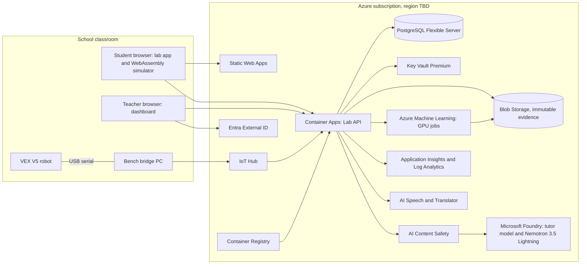

# AI Engineering Lab: startup plan

Draft for Microsoft Imagine Cup 2027, prepared 2026-11-06. The competition requirements and the checklist are in [MICROSOFT_IMAGINE_CUP_PLAN.md](MICROSOFT_IMAGINE_CUP_PLAN.md), and the product outline is in [`lab/`](../lab/README.md).

**Placeholders.** `[TBD: …]` marks information the founder must supply. Every number without a source is a placeholder; do not present it as a fact. Numbers about the existing software come from this repository (README, model cards, `docs/progress.md`).

## 1. Summary

**AI Engineering Lab teaches school students how to engineer with AI, using a VEX V5 robot as the test bench.** Students give an AI a task. The AI proposes a plan, a rules engine checks it, a simulator runs the same C++ controller as the real robot, and the student decides from measured results, not from what the AI says. The finished routine is then tested on the physical robot.

The product is built on a working stack: a C++20 motion controller compiled to WebAssembly, a rules engine for the current VEX game (Override), a trained tactical policy, an AI coordinator that fails closed, and an evidence system (RoboProof) that records every claim, including failures. On Azure it runs as a school SaaS. The company is a for-profit startup in Kazakhstan `[TBD: entity]`, with a pilot school ready `[TBD: school]`.

## 2. Problem

- Schools are asked to teach AI, but most AI lessons stop at using a chatbot. Students rarely learn the engineering loop: specify, let AI propose, check, measure, decide. `[TBD: cite a local policy or survey on AI education demand]`
- Robotics classes already own robots such as VEX V5 `[TBD: number of schools and clubs with VEX V5 in Kazakhstan, with source]`, but their lessons teach driving and block coding, not AI.
- Teachers lack the time and background to build AI-and-robotics lessons themselves. `[TBD: teacher prep time today, measured at the pilot school]`
- AI tools sound confident even when they are wrong. Students need a safe place to see that, and to learn that measurement decides.

## 3. Product and differentiation

### What a student does

1. Opens a lesson in the browser. No install is needed, because the simulator and the controller run in the page through WebAssembly.
2. States a task in plain language, for example "score 2 pins from the loader, then park".
3. Watches the AI propose actions. Each decision is a tool call that the rules engine checks. An invalid answer stops the run (fail closed), and the student sees why.
4. Runs the plan in the simulator, compares it with simple baselines, and reads the measured result.
5. Tunes, retrains or rewrites, and runs again.
6. Tests the finished routine on the class VEX V5 robot and measures the gap between simulation and reality.

### First lesson track (draft)

| # | Lesson | Engineering idea | Existing code it reuses |
| --- | --- | --- | --- |
| 1 | Drive and measure | Odometry versus ground truth; what a measurement is | `simulator/` (WebAssembly controller, encoder odometry) |
| 2 | Control loops | PI and feedforward, overshoot, tuning | `control.wasm` (the robot's C++ cascade) |
| 3 | Paths | Splines and Bézier paths, tracking error | Pedro Pathing C++ rewrite, quintic splines |
| 4 | Rules as code | Legal actions, score preview, edge cases | `simulator/override.js` rules engine |
| 5 | Learning from experience | Reinforcement learning, held-out tests, why a learned policy can lose | Tactical PPO policy (`roboproof/models/tactical-ppo-seed736001`) |
| 6 | Language models as coordinators | Tool calls, allowlists, failing closed | `roboproof/tactical-coordinator.js`, `roboproof/nemotron.js` |
| 7 | Evidence | Hashes, seeds, "one good run is not proof" | RoboProof run records |
| 8 | Simulation to reality | Running on the VEX V5 test bench and measuring the gap | PROS firmware, same C++ controller |

Lesson 5 uses a real result as teaching material: the bundled PPO policy scores a held-out mean margin of **201.5 against 244.5** for the team's scripted loading-zone tactic. It does not beat the hand-written tactic, and students learn to find that out by measuring.

### Teacher

The teacher sees a class dashboard with lesson progress, measured results and flagged AI moments (blocked or failed-closed requests). The teacher approves bench runs on the real robot, and can export a report for the school.

### Why customers would choose us, and what is hard to copy

- **Same code in the simulator and on the robot.** The browser runs the robot's own C++ controller through WebAssembly, so what students test is what the robot runs.
- **A rules engine for the current VEX game** scores every AI decision. VEX changes the game every season, so the engine and lessons are updated yearly. That gives customers a reason to renew, and it takes engineering depth to keep up.
- **AI that fails closed, plus evidence records.** The product teaches measurement over hype, and it shows students negative results honestly.
- **A tested base.** 619 automated Node tests, a trained tactical policy and a tool-calling coordinator are already working.
- **Limit (say it candidly).** A large company could write AI lessons. What is hard to copy is the validated controller, simulator and rules stack, plus the evidence culture around it.

## 4. Users and buyers

| Role | Who | What they need | Status |
| --- | --- | --- | --- |
| Student (daily user) | `[TBD: age range or grades]` | Clear tasks, quick feedback, a safe AI, the real robot | — |
| Teacher or robotics coach (daily user, champion) | `[TBD]` | Ready lessons, class overview, less prep time | Pilot teacher `[TBD: name, role]` |
| School director or owner (economic buyer, budget owner) | `[TBD]` | Outcomes for parents and inspectors, a predictable price | `[TBD]` |
| School IT administrator (security review) | `[TBD]` | Sign-in, data protection, no installs | `[TBD]` |
| Parents (consent, not buyers) | — | Child safety, privacy | Consent process `[TBD]` |
| Expansion buyers | School networks, private school groups, robotics clubs, regional education departments `[TBD: named targets]` | Many classrooms, one contract | — |

The day-to-day user is the student and teacher, and the buyer is the school. The Stage 4 judges ask for the path from champion (teacher) to budget owner (director) to signatory. That path at the pilot school is `[TBD]`.

## 5. Pilot

| Item | Plan |
| --- | --- |
| School | `[TBD: name, city, public or private]` |
| Cohort | `[TBD: number of students]` in `[TBD: grades]`, `[TBD: number]` VEX V5 kits |
| Duration | `[TBD: weeks]`, starting `[TBD: date, ideally by January 11, 2027]`, `[TBD: sessions per week]` |
| Scope | Lessons 1–6 in the simulator, then lesson 8 on the test bench |
| Agreement | Pilot agreement or letter of intent with the price after the pilot `[TBD]`, permission to be a named reference `[TBD]`. The school owns its data. |
| Consent | Parental consent and a privacy notice before any student data is collected `[TBD: legal review]` |

**Metrics.** Each one has a baseline, measured before the AI Engineering Lab lessons start.

| Metric | Definition | Baseline | Source | Owner |
| --- | --- | --- | --- | --- |
| Weekly active students | Students with at least one completed lesson step in the week ÷ enrolled students | 0 (new product) | App telemetry | Startup |
| Lesson completion | Completed lessons ÷ assigned lessons | — | App records | Startup |
| Concept gain | Score on the same `[TBD: number]`-question test of engineering-loop concepts, before and after | Pre-test `[TBD]` | Teacher-run test, not graded by AI | Teacher |
| Teacher prep time | Hours per lesson | `[TBD: today's hours]` | Teacher log | Teacher |
| Sim-to-real success | Student routines that work on the real robot on the first bench run ÷ routines tested | — | Bench records | Teacher and startup |
| Safety events | Blocked or flagged AI interactions; incidents | 0 | Content Safety and app logs | Startup |
| Conversion | Pilot to paid license, at `[TBD: price]` | — | Contract | Founder |

Snapshots are planned for December 31, January 31 and February 28. The judges expect six monthly observations and 12 months of retention, so the application will state candidly that the pilot is new.

**Success criteria:** `[TBD: agree them with the school before the start]`.

## 6. Business model

| Revenue stream | Price | Notes |
| --- | --- | --- |
| Annual school license (lessons, dashboard, AI usage quota, season updates) | `[TBD: price per classroom or per school, KZT and USD]` | Main stream |
| Teacher training and certification | `[TBD]` | Speeds up onboarding |
| Competition-team or club license | `[TBD]` | Robotics clubs and VEX teams |
| Season content pack (new VEX game: rules engine and lessons) | Included in the license, or `[TBD]` | Renewal driver |

Hardware is not sold. Schools use the VEX V5 kits they already own, or buy them through `[TBD: distributor partner]`.

**Unit economics** (measure during the pilot):

- Azure cost per active student per month: `[TBD]`. The physics runs in the browser, so the main server costs are API calls and model tokens.
- Gross margin: `[TBD]`
- Customer acquisition cost and payback: `[TBD]`

**Sales channel.** Teacher champions met at VEX competitions and training events `[TBD]`, direct sales to private schools `[TBD]`, then networks and education departments `[TBD]`. The sales cycle is tied to the school year, which starts on September 1 in Kazakhstan; the budget calendar is `[TBD]`.

## 7. Market and competition

**Bottom-up 3-year obtainable market** (the method the judges ask for; every value is a placeholder):

| Step | Value |
| --- | --- |
| Target accounts: schools and clubs with VEX V5 in Kazakhstan | `[TBD: count, with source]` |
| Accounts we can reach and close per year (sales capacity × win rate) | `[TBD]` |
| Average annual contract value | `[TBD]` |
| Year 1 / 2 / 3 obtainable revenue | `[TBD]` / `[TBD]` / `[TBD]` |
| Later expansion: Central Asia and other VEX markets | `[TBD]` |

**Current alternatives:** VEX's own curricula and coding tools `[TBD: verify the current offer]`, generic online AI courses, teachers' home-made materials, and other educational robotics platforms `[TBD: named competitors]`. What doing nothing costs the school: `[TBD: for example teacher hours, or no AI-engineering offer for parents]`.

## 8. Azure architecture

Imagine Cup requires Azure. The solution must run at least 10 Azure services, each showing at least $1.00 of usage, by February 28, 2027 (Official Rules §8).

### Today's stack and its Azure counterpart

| Today (hackathon build) | On Azure | Relation |
| --- | --- | --- |
| NVIDIA Nemotron 3.5 Lightning on Nebius Token Factory (tool-calling coordinator) | **Microsoft Foundry** (formerly Azure AI Foundry): NVIDIA Nemotron 3.5 Lightning through Fireworks on Foundry, which supports tool calling (Foundry blog, Aug 19, 2026) | Replaces. Nebius stays as an optional provider next to it, off by default, for comparison runs. |
| No tutor model | Microsoft Foundry model "Direct from Azure" for hints and explanations `[TBD: choose the model]` | New. Covered by Startup Credits, unlike partner-billed models. |
| Local Node server (`tools/start.js`, `roboproof/server.js`) | **Azure Container Apps** (the same Node server, containerized) | Replaces |
| Static files served by the local server | **Azure Static Web Apps** (app, simulator, `control.wasm`) | Replaces |
| API key in the Git-ignored `.cache/` folder | **Azure Key Vault** with managed identity | Replaces |
| Run records in `roboproof/runs/` and a private Drive folder | **Azure Blob Storage** with an immutability policy; evidence manifests signed with a Key Vault HSM key | Replaces |
| Training on a free Colab T4 and an AMD MI300X | **Azure Machine Learning** GPU jobs: bounded, scale to zero, approved budget only (`AGENTS.md`) | Replaces for the product |
| NVIDIA Cosmos-Reason2 adapter (inference not run yet) | Later: evaluate on Azure Machine Learning managed compute, if the license allows | Not in the MVP |
| GitHub Actions tests | GitHub Actions builds images into **Azure Container Registry** and deploys to Container Apps | Sits next to |

### Services

"Counts" means likely to show $1 or more of real pilot usage. Free tiers and free allowances show $0 and don't count. Prices are `[TBD: Azure Pricing Calculator]`.

| # | Service | Role | Counts toward the 10? |
| --- | --- | --- | --- |
| 1 | Azure Static Web Apps (Standard plan) | Hosts the lab app, simulator and WebAssembly controller | Yes, plan fee (the Free plan would not count) |
| 2 | Azure Container Apps | Lab API: lessons, checks, tutor gateway, tactics and match endpoints | Check: there is a monthly free grant. Keep the API always on (minimum 1 replica). |
| 3 | Azure Container Registry (Basic) | API and job images | Yes, daily fee |
| 4 | Microsoft Foundry Models (Direct from Azure) | Tutor model | Check token volume |
| 5 | Azure AI Content Safety (Standard) | Harm filters and Prompt Shields on every model input and output | Check volume; don't use the free tier |
| 6 | Azure Database for PostgreSQL – Flexible Server | Schools, classes, pseudonymous students, progress | Yes, compute hours |
| 7 | Azure Blob Storage | Evidence bundles, replays, bench videos, policy artifacts | Check volume |
| 8 | Azure Key Vault (Premium) | Secrets; HSM key that signs evidence manifests | Likely, per-key fee `[TBD: verify]` |
| 9 | Azure Monitor: Application Insights and Log Analytics | Telemetry, availability tests, alerts, incident timeline | Check: free ingestion allowance |
| 10 | Azure Machine Learning | GPU jobs: PPO retraining, evaluation campaigns | Yes, once a job runs (needs an approved budget) |
| 11 | Azure IoT Hub (Basic or Standard tier) | Test-bench telemetry from the classroom bridge PC | Yes, unit fee (the Free tier would not count) |
| 12 | Azure AI Speech | Reads lesson text aloud in Kazakh, Russian and English | Check volume |
| 13 | Azure AI Translator | Draft translations of lessons, reviewed by a teacher | Check volume |
| 14 | Microsoft Defender for Cloud | Security posture and threat protection for containers, storage and databases | Likely, per-resource plans `[TBD: verify]` |
| — | Microsoft Entra External ID | Teacher sign-in | Probably $0 under the free allowance; doesn't count |

**Plan for 12 or more, not exactly 10.** The rules don't define how a "unique service" is counted, and Cost Management may group several AI services under one service name. Ask `imagine@microsoft.com` how services are counted, and check usage in Cost Management by **February 14, 2027**. Every service must have a real role; padding would hurt the "service-selection rationale" score.

### Diagram (draft)

### Data flows and security boundaries

1. **Browser (untrusted).** Physics and the controller run locally in WebAssembly. The browser sends lesson actions and measured results to the API, and it never holds keys.
2. **Lab API (trusted).** Validates every request, reaches other services through managed identity, and stores progress against pseudonymous student IDs.
3. **Model boundary.** Models only choose from allowlisted tool calls. Their answers are validated, and an invalid answer fails closed (the existing coordinator contract). Content Safety checks inputs and outputs. No personal data goes into prompts, which matters because Nemotron on Fireworks runs in the "US Data Zone".
4. **Data boundary.** Students have pseudonymous IDs. The class roster with real names stays with the school `[TBD: confirm with a Kazakhstan lawyer, including data-localization rules]`. Data is encrypted at rest and in transit, and retention is `[TBD]`.
5. **Physical boundary.** The AI never drives the real robot directly. Bench runs execute the student's approved routine through the PROS firmware, with a teacher present.

**Region:** `[TBD: choose after the legal review; there is no Azure region in Kazakhstan]`.

**Credits and cost.** $1,000 after the code, $5,000 after approval, then $25,000, $50,000 and $150,000 at the workload milestones (Official Rules §6). The partner-billed Nemotron route is most likely pay-as-you-go. Monthly Azure budget: `[TBD]`. Set budget alerts at `[TBD]`.

## 9. Responsible AI, safety and reliability

- **Measurement decides.** The AI never grades. Lesson checks are deterministic tests on simulator and bench measurements. Model commentary is advice only, the same rule the project already follows for motion evidence.
- **Fail closed.** Tool allowlists, schema validation, and a hard stop on invalid answers (already implemented in the coordinator). The student sees the reason.
- **Child safety.** Content Safety harm filters and Prompt Shields, a school blocklist, and no open chat. The tutor answers only inside the lesson context. Age policy: `[TBD]`.
- **Identity.** Teachers sign in with Entra External ID. Students use a class code and a teacher-issued pseudonymous login, with no email address.
- **Secrets.** Managed identity and Key Vault; no keys in code.
- **Observability.** Application Insights, availability tests and alerts.
- **Reliability.** Target availability `[TBD]`. If the model endpoint fails, lessons keep working, because the simulator runs in the browser and the coordinator falls back to the scripted tactic. Releases use Container Apps revisions, so a bad release can be rolled back.
- **Failure drill (before February 14, 2027).** Switch off the model endpoint and deploy a broken API revision. Measure detection time, recovery time, root cause and corrective action. The Stage 4 judges ask for this evidence.
- **10× scale.** Most compute is in students' browsers. The expected bottlenecks are model rate limits and database connections `[TBD: load test]`. Cost per active student at 10× is `[TBD]`.
- **Robot safety.** A marked test area, a teacher present, speed limits in lessons, and the V5 controller as the stop switch.

## 10. Roadmap

| When | Milestone |
| --- | --- |
| Nov 9–15, 2026 | Decide the category and team; confirm the entity; create the Award Force account |
| Nov 16–29 | Microsoft for Startups code; Azure subscription; business verification started; pilot agreement drafted |
| Dec 1–15 | NVIDIA × Nebius judging: the default branch stays frozen; work continues on this branch |
| Nov 16 – Dec 20 | MVP v0: lessons 1–3, teacher view, Foundry provider, first Azure deployment (services 1–3, 6–9) |
| Dec 21 – Jan 10 | Lessons 4–6, Content Safety, tutor model, consent forms, teacher training |
| By Jan 11, 2027 | Pilot starts on the Azure deployment |
| Jan 11 – Feb 14 | Weekly pilot sessions, January 31 metric snapshot, bounded Azure ML job, IoT Hub bench bridge, failure drill, all services at $1 or more |
| Feb 15–25 | Pitch deck, team-made demo video, architecture diagram, written answers; submit by February 25 |
| Feb 28, 23:59 CST | Hard deadline (March 1, 10:59 Astana) |
| Mar 1–31 | Expert review; recorded English interview (rehearse the pitch, demo and Q&A) |
| Apr – Jun 2027 | Final judging; if selected, verification, mentoring and the U.S. World Championship |
| Next 12 months | `[TBD: number of schools]`, the next VEX season content pack, Kazakh and Russian lessons, network contracts |

**Demo video shot list (2–3 minutes; filmed and edited by the team).** Use no third-party music or footage without a license.

1. 0:00–0:15. The problem: a class with robots and no AI-engineering lessons (teacher on camera).
2. 0:15–1:30. A student flow: task, AI proposal, rules check, simulator run, measured result. Include one fail-closed moment.
3. 1:30–2:05. The same routine on the real VEX V5, and the measured gap between simulation and reality.
4. 2:05–2:30. The teacher dashboard and the Azure architecture.
5. 2:30–2:50. The pilot's measured result and the ask.

## 11. Team

| Member | Role | Background | Commitment |
| --- | --- | --- | --- |
| `[TBD: founder's full legal name]` | Founder; CEO and technical lead; Authorized Representative | Built this project's controller, simulator, Pedro Pathing C++ rewrite, Tactical AI and RoboProof `[TBD: education, VEX record]` | `[TBD]` |
| `[TBD]` | `[TBD: for example curriculum and teacher success]` | `[TBD]` | `[TBD]` |
| `[TBD]` | `[TBD: for example sales and partnerships]` | `[TBD]` | `[TBD]` |
| `[TBD]` | `[TBD: for example full-stack and Azure]` | `[TBD]` | `[TBD]` |
| Advisor: `[TBD: pilot teacher]` | Pedagogy | `[TBD]` | Not an official member and can't receive prizes (Official Rules §14) |

There is a limit of 4 official members, all 18 or older and named before February 28, 2027.

## 12. Funding and use of funds

| Item | Value |
| --- | --- |
| Raised so far | `[TBD]` |
| Planned financing (amount, type, timing) | `[TBD]` |
| Use of funds | `[TBD: for example curriculum, sales, Azure, legal]` |
| Monthly burn and base-case runway | `[TBD]` |
| Main diligence risk and mitigation | Children's data compliance; mitigation: legal review, pseudonymous design, consent `[TBD]` |

Azure Startup Credits are non-cash support and are not counted as funding.

## 13. Microsoft growth alignment

The judges ask how Microsoft technologies, programs or channels could help the startup grow. Per the rules, this implies no commitment by Microsoft.

- **Microsoft for Startups:** credits and technical guidance for the Azure deployment.
- **Microsoft Foundry:** NVIDIA Nemotron and Direct-from-Azure models in one governed project, with Content Safety in front of both.
- **Schools on Microsoft 365:** let teachers sign in with their school accounts through Microsoft Entra ID, and consider publishing lessons as Microsoft Teams assignments `[TBD: check integration options]`.
- **Azure Marketplace:** list the product so networks and departments can buy through existing procurement (later).
- **GitHub:** CI/CD today. Older students can export their routines as code to GitHub.

## 14. Risks and open items

- Entity, team, pilot school and budget details: see the questions in [MICROSOFT_IMAGINE_CUP_PLAN.md §13](MICROSOFT_IMAGINE_CUP_PLAN.md#13-questions-for-the-founder).
- Kazakhstan personal-data rules for children and data localization: legal review needed `[TBD]`.
- Whether Microsoft for Startups credits cover any Nemotron route: check the "Direct from Azure" collection in the Foundry portal.
- The copyright holder name in `LICENSE` and the notices must be corrected to the founder's legal name, and the IP assigned to the company.

## Appendix A. Evidence that exists today

| Claim | Where |
| --- | --- |
| C++20 LTV-LQR to wheel-PI + feedforward controller, the same code compiled to WebAssembly | `include/`, `src/`, `simulator/control.wasm`, README "Project architecture" |
| Override rules engine and browser simulator | `simulator/override.js`, `simulator/README.md` |
| Tactical PPO policy: 28,034 parameters; held-out margin 201.5 vs 244.5 for the loading-zone tactic | `roboproof/models/tactical-ppo-seed736001/README.md` |
| Nemotron 3.5 Lightning coordinator: mean margin 231 vs 246 for the loading-zone tactic (seeds 101–102) | README "NVIDIA Nemotron and Nebius Token Factory" |
| Fail-closed tool calls with allowlisted candidates | `roboproof/tactical-coordinator.js`, `roboproof/NEMOTRON.md` |
| Evidence records: hashes, exposure ledgers, `learnedImprovementVerified: false` unless independently checked | `roboproof/`, `docs/REMOTE_TRAINING_CUSTODY.md` |
| 619 Node tests | `npm test` |
| Licenses and third-party notices | `LICENSE`, `THIRD_PARTY_NOTICES.md` |
